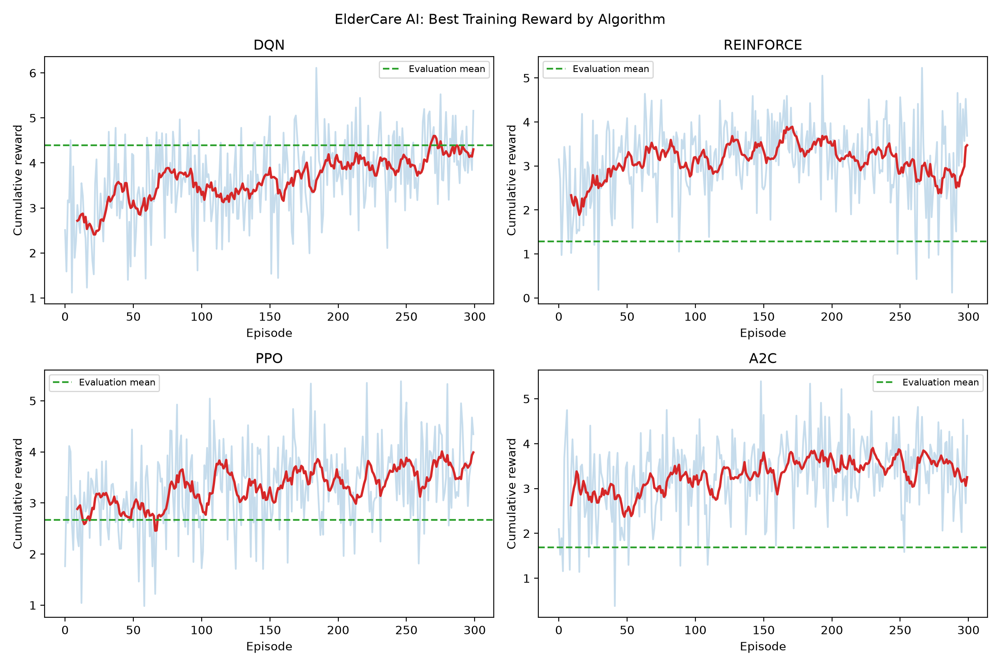

# ElderCare AI

### Reinforcement Learning for Personalized Older-Adult Wellbeing Support

ElderCare AI is a mission-driven reinforcement learning project that compares **DQN, REINFORCE, PPO, and synchronous A2C** on a custom Gymnasium environment using PyTorch and TorchRL.

The project represents a digital wellbeing-support agent that recommends suitable daily activities to fictional older-adult profiles. It addresses social isolation, inconsistent routines, low physical activity, hydration, mood, and cognitive engagement through sequential decision-making.

> **Educational scope:** This is a fictional synthetic simulation, not a medical device or clinical decision-making system.



## Why reinforcement learning?

The support assistant makes one recommendation each simulated hour. An action changes wellbeing indicators that affect every later decision. It must balance:

- Immediate wellbeing improvement
- Delayed benefits from sustained routines
- Individual preferences and mobility
- Recommendation fatigue and repetition
- Social or community connection
- The possibility that a recommendation is rejected

Because there is no fixed correct action and the state evolves after every choice, ElderCare AI is a sequential decision problem rather than one-shot ranking or classification.

## Environment

The custom Gymnasium environment is implemented in `environment/custom_env.py`.

### Episode design

- A simulated profile is randomized at reset
- An episode represents one 12-hour day
- One hour advances per action
- Start time: 08:00
- End time: 20:00
- Termination: critical synthetic wellbeing threshold
- Truncation: 12 decisions reached

The environment is compatible with Gymnasium's `terminated` and `truncated` contract.

### Actions — discrete 8

| ID | Action | Real-world translation |
|---:|---|---|
| 0 | No intervention | Avoid unnecessary or low-value prompts |
| 1 | Encourage hydration | Accessible hydration reminder |
| 2 | Suggest suitable physical activity | Mobility-aware movement suggestion |
| 3 | Encourage social connection | Call, conversation, or social check-in |
| 4 | Suggest rest | Break or rest recommendation |
| 5 | Encourage mental stimulation | Reading, puzzle, music, or similar activity |
| 6 | Recommend accessible community activity | Preference-matched community support |
| 7 | Offer daily-routine assistance | Manageable routine reminders or task support |

### Observations — normalized 8

All observations are `numpy.float32` values in `[0, 1]`.

| Observation | Meaning | Simulation update | Future real-world source |
|---|---|---|---|
| Energy | Synthetic available energy | Natural decay and rest action | Consented wearable trend or user input |
| Social connection | Synthetic social wellbeing | Social actions increase it | Consented check-ins or communication API |
| Physical activity | Synthetic movement level | Mobility-dependent activity action | User-confirmed activity or consented tracker |
| Hydration | Synthetic hydration support need | Natural decay and hydration action | Consented app logging or reminder confirmation |
| Mood | Synthetic emotional wellbeing | Social, rest, and activity effects | Consented self-report |
| Cognitive engagement | Synthetic mental engagement | Mental actions and natural decay | Opt-in activity or app usage data |
| Routine completion | Synthetic daily-routine progress | Routine actions increase it | User-confirmed task completion |
| Time of day | 08:00–20:00 normalized as `(hour - 8) / 12` | Increases every hour | Local device clock |

These values are not clinical measurements or real-person records.

### Reward

```text
Reward = 2.0 × weighted wellbeing improvement
       + 0.8 × action fit
       - inappropriate-action penalty
       - immediate repetition penalty
       - rejection penalty
```

Wellbeing improvements are weighted across energy, social connection, physical activity, hydration, mood, cognitive engagement, and routine completion. Immediate repetition adds a penalty, poorly fitted actions receive an inappropriate-action penalty, and rejection adds a consent-sensitive penalty.

## Visual simulation

`environment/rendering.py` provides a Pygame 2D GUI that displays:

- Fictional older-adult profile
- Current simulated time
- Seven wellbeing indicators
- Selected agent action
- Recommendation accepted/rejected status
- Step reward
- Cumulative reward
- Episode progression

Pygame is appropriate for this abstract state-driven system. A physical 3D environment would not add proportional educational or assignment value.

## Algorithms

All algorithms interact with the same environment and 12-step episode budget.

### DQN

- 8→64→64→8 Q-network
- Experience replay
- Target network
- Epsilon-greedy exploration
- Bellman targets
- Smooth-L1 loss
- Adam optimizer
- Replay, batch, gamma, epsilon, and target-update sweeps

### REINFORCE

- Categorical stochastic policy
- Complete-episode collection
- Discounted returns
- Optional return normalization
- Entropy regularization
- Learning-rate, gamma, hidden-size, and entropy sweeps

### PPO

- Actor-critic network
- Categorical policy logits
- Scalar critic
- GAE advantages
- Clipped policy objective
- Value-loss term
- Entropy bonus
- Multiple optimization epochs

### Synchronous A2C

- Shared actor-critic features
- Categorical actor
- Scalar critic
- Episodic advantages
- Separate actor and critic updates
- Entropy and value-loss regularization
- Configurable rollout length

## TorchRL decision

TorchRL 0.15.0 is used to verify and wrap the Gymnasium environment through `GymWrapper(categorical_action_encoding=True)`. `main.py smoke` checks reset and random-step TensorDict behavior.

The four algorithms are implemented in PyTorch directly on the same `ElderCareEnv` specification. This avoids silently substituting another algorithm and keeps the environment, actions, observations, reward, seed, horizon, and evaluation procedure comparable.

## Hyperparameter experiments

The final sweep trains 10 configurations for every required algorithm: 40 configurations in total.

```powershell
uv run main.py train --episodes 300 --runs-per-algorithm 10 --seed 42
```

Current evidence is stored in `logs/`:

- `dqn_experiments.csv` and `.json`
- `reinforce_experiments.csv` and `.json`
- `ppo_experiments.csv` and `.json`
- `a2c_experiments.csv` and `.json`
- `analysis_summary.csv` and `.json`

Figures are stored in `assets/`:

- `reward_comparison.png`
- `evaluation_comparison.png`
- `dqn_loss.png`
- `reinforce_entropy.png`
- `ppo_entropy.png`
- `a2c_entropy.png`
- `ppo_loss.png`
- `a2c_loss.png`
- `reinforce_loss.png`

### Experiment evidence

- `assets/all_runs_table.csv`: combined 40-run hyperparameter and evaluation table
- `logs/`: detailed per-algorithm JSON and CSV records
- `assets/`: reward, evaluation, loss, entropy, and convergence-compatible plots

## How to run

Requirements:

- Windows or another supported platform
- Python 3.12
- `uv` installed

```powershell
cd C:\Users\Administrator\eldercare_rl_summative
uv sync
uv run main.py test
uv run main.py smoke
```

### Pygame gameplay

Random-policy demonstration:

```powershell
uv run main.py demo --algorithm random --hold-seconds 60
```

Best trained DQN:

```powershell
uv run main.py demo --algorithm dqn --hold-seconds 60
```

Policy-gradient demonstrations:

```powershell
uv run main.py demo --algorithm reinforce --hold-seconds 60
uv run main.py demo --algorithm ppo --hold-seconds 60
uv run main.py demo --algorithm a2c --hold-seconds 60
```

The Pygame window remains open after the episode for the selected hold time. Press `Ctrl+C` or close the window to exit.

### Results

```powershell
uv run main.py evaluate
uv run main.py plots
```

## Project structure

```text
eldercare_rl_summative/
├── environment/
│   ├── custom_env.py
│   └── rendering.py
├── training/
│   ├── dqn_training.py
│   ├── pg_training.py
│   └── analysis.py
├── tests/
├── logs/
├── assets/
├── models/
├── main.py
├── pyproject.toml
├── uv.lock
└── README.md
```

## Limitations

- Wellbeing observations are synthetic and must not be treated as clinical measurements
- Profiles and transition rules are fictional
- Evaluation is performed on held-out seeds, not real users
- The 12-step horizon limits long-term planning
- Rejection behavior and recommendation fit are simulation assumptions
- Final evidence is limited to the tested 300-episode training budget
- More seeds, longer horizons, real consent, accessibility testing, and human oversight would be required before any real deployment

## Reproducibility

Use only `uv` commands to install dependencies and execute the project:

```powershell
uv sync
uv run main.py test
uv run main.py train --episodes 300 --runs-per-algorithm 10 --seed 42
uv run main.py plots
```

Do not commit `.venv`, Python caches, private data, or temporary output files. Commit intended experiment logs, selected plots, and final evaluation checkpoints for reproducible evidence.
