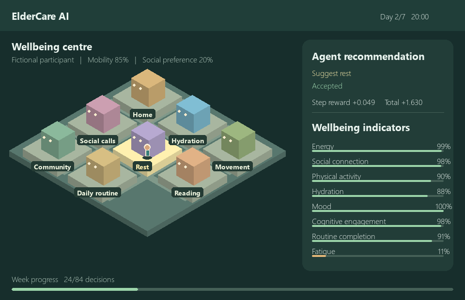

# ElderCare AI

ElderCare AI compares DQN, REINFORCE, PPO, and Advantage Actor-Critic (A2C) in a custom Gymnasium environment. It models an assistant that recommends wellbeing activities to fictional older adults and takes account of preferences, mobility, fatigue, and declined suggestions.

> My personal mission as a software engineer is to empower old age wellbeing specifically, through the creation of human-centred digital solutions and community-oriented systems, which will enable older adults to experience more fulfilling, connected, and healthy lives.



## Run the project

From the cloned repository root, with `uv` installed:

```text
uv sync --locked
uv run main.py test
uv run main.py smoke
uv run main.py evaluate
uv run main.py demo --algorithm best
```

The lockfile selects dependencies for Python 3.12. The demo loads the checkpoint with the highest validation mean and prints each action, its acceptance status, reward, and the current wellbeing average. Pass `--algorithm dqn`, `reinforce`, `ppo`, `a2c`, or `random` to inspect another policy.

## Environment

Each episode starts on day one at 08:00. A seeded reset samples a profile and seven wellbeing indicators between 0.45 and 0.75. The simulation uses 12 decision slots per day for seven days.

| Action | Real-world equivalent |
|---|---|
| 0. No intervention | Give the person space |
| 1. Hydration | Offer an accessible hydration reminder |
| 2. Suitable physical activity | Suggest movement suited to mobility |
| 3. Social connection | Suggest a call, conversation, or check-in |
| 4. Rest | Suggest a break |
| 5. Mental stimulation | Suggest a puzzle, reading, or music |
| 6. Accessible community activity | Suggest a community activity suited to the person |
| 7. Daily routine assistance | Offer support with a manageable daily task |

The 18 observations are normalized to [0, 1]. They include seven wellbeing indicators (energy, social connection, physical activity, hydration, mood, cognitive engagement, and routine completion), time of day, fatigue, an eight-value one-hot previous action, and elapsed week progress. Profile preferences and scheduled delayed effects influence transitions. These are latent inputs to the simulator.

The reward is five times the weighted wellbeing change, plus a small action-fit bonus, minus penalties for unsuitable, repeated, and declined recommendations. No intervention has its own context-dependent bonus. A declined recommendation has no direct action effect. Accepted recommendations may change indicators immediately and schedule a benefit for the following decision. Natural changes apply each step.

An episode terminates after three consecutive steps with at least three wellbeing indicators below 0.18. It otherwise truncates at 84 steps. The Pygame/SDL2 scene highlights the recommended station in an isometric wellbeing centre. The participant moves there after an accepted prompt and stays put after a decline. The renderer prefers the OpenGL presentation backend and can use the platform's fallback backend. The environment also provides an offscreen RGB frame and text output.

## Algorithms and experiments

| Algorithm | Training method |
|---|---|
| DQN | TorchRL replay buffer, epsilon-greedy exploration, and target-network Bellman updates |
| REINFORCE | TorchRL categorical log-probabilities and entropy and Monte Carlo policy gradients |
| PPO | TorchRL categorical log-probabilities and entropy, generalized advantage estimation, and a clipped probability-ratio objective |
| A2C | TorchRL categorical log-probabilities and entropy and n-step, bootstrapped actor-critic updates |

All the learners use the same Gymnasium environment. The TorchRL smoke check also exercises the Gymnasium wrapper. The logged sweep uses 10 distinct configurations per algorithm and 300 episodes per configuration. Greedy rollouts on 20 common validation seeds determine the selected run per algorithm. The independent test compares those saved policies with a uniform random agent over 50 additional seeds.

```text
uv run main.py train --episodes 300 --runs-per-algorithm 10 --seed 42
uv run main.py plots
uv run main.py evaluate
```

- [All 40 configurations and validation results](assets/all_runs_table.csv)
- [Selected runs](logs/analysis_summary.csv)
- [Independent test results](logs/test_evaluation.csv)
- [Sampled-policy and heuristic diagnostics](logs/evaluation_diagnostics.csv)
- [Training reward curves](assets/reward_comparison.png)
- [Training stability](assets/stability_comparison.png)
- [Convergence curves](assets/convergence_comparison.png)

On the 50 independent test seeds, DQN averaged +1.03 reward versus -0.81 for the immediate-fit heuristic, which has access to latent profile preferences. With no prompts, all 50 episodes ended early under the default critical threshold. Sampling PPO actions improved its mean return from -0.44 to +0.45. These diagnostics are generated by the evaluation command.

The simulator uses synthetic profiles, scores, and response probabilities. The findings apply to this simulated environment. Each configuration has one training seed and can vary multiple settings at once, so the sweep supports comparisons between configurations.

## Repository layout

- `environment/` contains the Gymnasium environment and rendering.
- `training/` contains the four learners and analysis tools.
- `models/` contains saved validation-selected policies.
- `logs/` and `assets/` contain experiment evidence.
- `tests/` checks environment, rendering, TorchRL and training behaviour.
